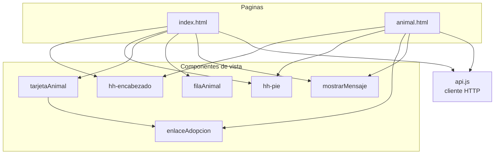

# 1. Componentes: inventario, repeticiones y propuesta

Actividades de la clase 4 (Componentes): inventario de la aplicación, búsqueda de repeticiones y diagrama de componentes.

## 1.1 Inventario de la aplicación

### Páginas

| Página | Archivo | Estado |
|---|---|---|
| Inicio (presentación, cifras) | `refugio-html5/index.html#inicio` | Existe |
| Catálogo de animales | `refugio-html5/index.html#animales` | Existe, ahora con datos de la API |
| Detalle de un animal | `refugio-html5/animal.html?id={id}` | **Nueva** |
| Cómo adoptar | `refugio-html5/index.html#como-adoptar` | Existe |
| Solicitud de adopción | `refugio-html5/index.html#solicitud` | Existe, ahora envía a la API |
| Voluntarios | `refugio-html5/index.html#voluntarios` | Existe, ahora envía a la API |
| Contacto | `refugio-html5/index.html#contacto` | Existe |
| Panel de administración | `refugio-html5/admin.html` | **Nueva** (solo personal: inicio de sesión, solicitudes y voluntarios) |
| Administración de Django | `/admin/` | **Nueva** (respaldo técnico; usa las mismas reglas) |

### Funcionalidades

- Consultar animales en adopción (todos o filtrados por especie).
- Consultar la ficha de un animal.
- Registrar una solicitud de adopción.
- Registrarse como voluntario.
- Administrar animales: crear, editar, cambiar estado, eliminar (solo administradores).
- Consultar solicitudes recibidas (solo administradores).

## 1.2 Búsqueda de repeticiones

🔴 repetido · 🟠 difícil de mantener · 🟡 dependiente · 🟢 reutilizable

```
Inicio (index.html)
├── Encabezado (logo + nombre + lema) 🔴
├── Menú principal 🔴
├── Tarjeta de animal ×6 🔴🟠 (copiada a mano 6 veces; cada cambio de datos se hacía en 2 lugares: tarjeta y tabla)
├── Tabla resumen de animales 🟠🟡 (dependía de que alguien la actualizara igual que las tarjetas)
├── Lista de animales del <select> del formulario 🟠🟡 (tercera copia de los mismos datos)
├── Formulario de solicitud
├── Mensajes de éxito/error 🟢
└── Pie de página 🔴

Detalle (animal.html)
├── Encabezado 🔴
├── Menú principal 🔴
├── Ficha del animal 🟡
└── Pie de página 🔴
```

**Hallazgo principal:** los datos de cada animal estaban escritos **tres veces** (tarjeta, tabla y opción del formulario). Si Zeus pasaba a "adoptado", había que cambiar tres partes del HTML, y bastaba olvidar una para que la página se contradijera.

## 1.3 Componentes propuestos e implementados

Todos viven en `refugio-html5/js/componentes.js`.

| Componente | Responsabilidad única | Se reutiliza en | Por qué es componente |
|---|---|---|---|
| `<hh-encabezado>` | Logo, nombre y menú principal | index.html, animal.html, admin.html | Se repetía en cada página; el menú se cambia en un solo lugar |
| `<hh-pie>` | Pie de página con créditos | index.html, animal.html, admin.html | Se repetía en cada página |
| `tarjetaAnimal(animal)` | Presentar un animal en el catálogo | Catálogo (6 o más veces) | Antes eran 6 bloques copiados |
| `filaAnimal(animal)` | Presentar un animal en la tabla resumen | Tabla resumen | Se alimenta de los mismos datos que la tarjeta |
| `enlaceAdopcion(animal)` | Botón "Quiero adoptar" o etiqueta de estado | Tarjeta y ficha de detalle | La regla "solo se adopta si está disponible" se presenta igual en todos lados |
| `mostrarMensaje(...)` | Mensajes de éxito, aviso y error | Formulario, catálogo, detalle | Mismo estilo y accesibilidad (`aria-live`) en toda la app |
| `api.js` | Comunicación HTTP con el backend | Todas las páginas | Un solo lugar sabe la URL de la API y el formato de error |
| `formularios.js` | Marcar en rojo los campos que el servidor rechazó y listar sus errores | Solicitud de adopción, registro de voluntarios y motivo de rechazo en el panel | Surgió al conectar el segundo formulario: la misma lógica estaba a punto de copiarse |
| `estilos.css` (variables `:root`) | Colores y medidas | Todas las páginas | "Cambiar el menú de azul a verde" es cambiar una variable |



## 1.4 Decisión más difícil

**¿Los formularios deben ser componentes?** Decidimos que **no**: cada formulario aparece en una sola página y tiene campos distintos. Convertirlos en componentes solo añadiría archivos. Sí extrajimos lo que se repite entre ellos: el cliente HTTP (`api.js`), los mensajes (`mostrarMensaje`) y el marcado de errores (`formularios.js`). Este último se extrajo justo cuando apareció la repetición, al conectar el formulario de voluntarios.

**Pregunta crítica que queda abierta:** ¿qué pasa si el menú necesita opciones distintas según el tipo de usuario (visitante o administrador)? Ya existe inicio de sesión (`admin.html`), pero decidimos **no** mostrar un enlace de administración en el menú público. El acceso está solo en el pie de página. Si en el futuro el menú cambia según la sesión, `<hh-encabezado>` podría leer `sesion.obtener()` de `api.js`.
