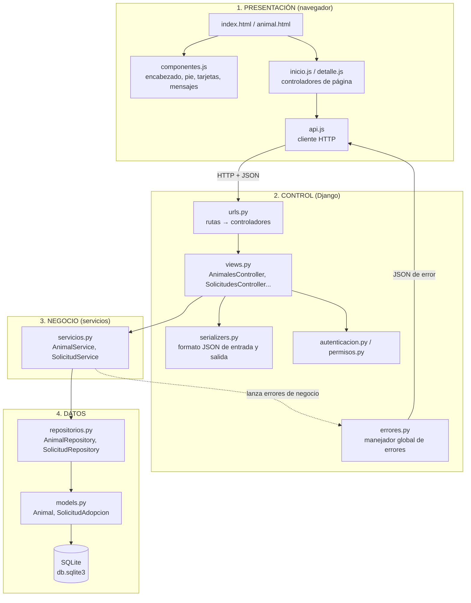

# 2. Arquitectura por capas

> **Actualización (entrega 4, 23/11/2026):** el sitio dejó de ser una sola página. Las páginas ahora son plantillas de Django en `backend/sitio/templates/sitio/` y las direcciones son `/`, `/animales/`, `/adoptar/`, `/voluntarios/`, `/mi-solicitud/`, `/contacto/` y `/panel/`. Este documento conserva la actividad tal como se entregó; la estructura actual está en [07-sitio-django.md](07-sitio-django.md).

Actividad central de la clase "Arquitectura por capas": mapa con 4 capas, componentes ubicados, flechas de comunicación y una responsabilidad por componente.

## 2.1 Mapa de arquitectura

Cada capa solo conoce a la capa de abajo. El navegador nunca toca la base de datos y el servicio nunca arma respuestas HTTP.

## 2.2 Responsabilidad de cada capa

| Capa | Responsabilidad | Archivos | No debe |
|---|---|---|---|
| Presentación | Mostrar información, capturar datos, enviar solicitudes, presentar mensajes y errores | `refugio-html5/` | Decidir reglas de negocio ni guardar datos |
| Control | Recibir la petición, validar el formato, verificar quién es y qué puede hacer, llamar al servicio, devolver código HTTP + JSON | `views.py`, `urls.py`, `serializers.py`, `permisos.py`, `autenticacion.py`, `errores.py` | Contener reglas del negocio o consultas |
| Negocio | Aplicar las reglas de la fundación (edad mínima, disponibilidad, duplicados, horario de visitas) | `servicios.py` | Conocer HTTP o SQL |
| Datos | Consultar, insertar, actualizar y eliminar | `repositorios.py`, `models.py` | Decidir permisos o respuestas HTTP |

## 2.3 Actividad "¿Dónde pertenece?" aplicada a Huellitas

| Acción | Capa | Justificación |
|---|---|---|
| Mostrar el formulario de solicitud | Presentación | Es lo que el usuario ve (`index.html`) |
| Recibir `POST /api/solicitudes/` | Control | Es la entrada HTTP (`SolicitudesController.post`) |
| Comprobar que el celular tenga 10 dígitos | Control | Es validación de formato (`SolicitudEntradaSerializer`) |
| Comprobar que el solicitante sea mayor de 18 años | Negocio | Es una regla de la fundación (`SolicitudService`) |
| Comprobar que el animal esté disponible | Negocio | Regla de negocio que depende del estado del animal |
| Guardar la solicitud | Datos | `SolicitudRepository.guardar` |
| Mostrar "¡Solicitud #12 recibida!" | Presentación | `mostrarMensaje` en `inicio.js` |

## 2.4 Acoplamiento y cohesión

- **Bajo acoplamiento:** si cambiamos SQLite por PostgreSQL u Oracle, solo cambia `settings.py` (y, si hiciera falta, `repositorios.py`). Los servicios y controladores no se tocan.
- **Bajo acoplamiento en el frontend:** si la URL de la API cambia, solo se modifica `BASE_API` en `api.js`.
- **Alta cohesión:** `servicios.py` contiene solo reglas; `repositorios.py` solo acceso a datos; `componentes.js` solo presentación.
- **Acoplamiento que aún existe:** la ruta de las fotos (`img/luna.jpg`) se guarda en la base de datos y depende de la estructura de carpetas del frontend. Cuando se suban fotos reales habrá que guardarlas como archivos del backend.

## 2.5 Decisión difícil

**¿Dónde validar?** En tres lugares, cada uno con un propósito distinto:

1. **HTML5** (`required`, `pattern`, `min`): ayuda rápida al usuario. Se puede saltar, así que no se confía en ella.
2. **Serializer** (capa de control): formato de la petición. Si falla, la solicitud ni siquiera llega al servicio (400).
3. **Servicio** (capa de negocio): reglas de la fundación (edad, disponibilidad, duplicados, horario).

La validación de formato y la de negocio no están duplicadas: una pregunta "¿el dato está bien escrito?" y la otra "¿la fundación lo permite?".
