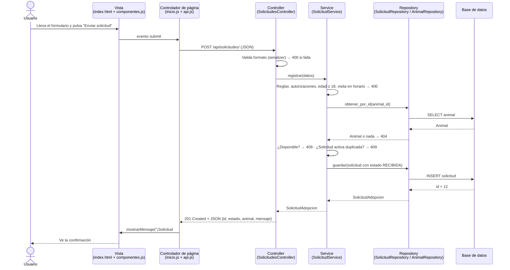
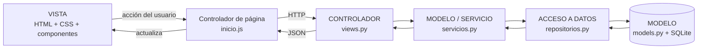

# 3. Modelo – Vista – Controlador (MVC)

Producto del equipo de la clase MVC: modelos principales, vistas, controladores, flujo de una funcionalidad y diagrama MVC.

## 3.1 Modelos principales (`backend/adopciones/models.py`)

| Modelo | Atributos | Estados |
|---|---|---|
| **Animal** | id, nombre, especie, raza, sexo, edad_meses, tamaño, salud, descripción, historia, foto, estado, fecha_ingreso | DISPONIBLE, EN_PROCESO, ADOPTADO |
| **SolicitudAdopcion** | id, animal, nombre, tipo_documento, documento, fecha_nacimiento, correo, teléfono, dirección, ciudad, tipo_vivienda, tenencia, personas_hogar, otras_mascotas, horas_solo, fecha_visita, hora_visita, motivo, medio, acepta_datos, acepta_visita, estado, fecha_creacion | RECIBIDA, EN_REVISION, APROBADA, RECHAZADA |
| **Usuario** (de Django) | usuario, contraseña, is_staff | administrador / no administrador |
| **Voluntario** | id, nombre, correo, teléfono, edad, red_social, disponibilidad, área, experiencia, comentarios, acepta_datos, estado, fecha_registro | PENDIENTE, ACTIVO, INACTIVO |

## 3.2 Vistas

| Vista | Archivo | Qué presenta |
|---|---|---|
| Catálogo de animales | `index.html#animales` | Tarjetas, filtro por especie y tabla resumen |
| Ficha del animal | `animal.html?id={id}` | Foto, datos y botón de adopción |
| Formulario de solicitud | `index.html#solicitud` | Formulario y mensajes de respuesta |
| Registro de voluntarios | `index.html#voluntarios` | Calendario de jornadas, formulario y mensajes de respuesta |
| Panel de administración | `admin.html` | Inicio de sesión, tablas de solicitudes y voluntarios con botones de estado, detalle y diálogo de rechazo |
| Administración de Django | `/admin/` | Gestión técnica de animales, solicitudes y voluntarios |

## 3.3 Controladores

| Controlador | Archivo | Recibe | Coordina con |
|---|---|---|---|
| `AnimalesController` | `views.py` | GET y POST `/api/animales/` | `AnimalService` |
| `AnimalDetalleController` | `views.py` | GET, PUT, PATCH, DELETE `/api/animales/{id}/` | `AnimalService` |
| `SolicitudesController` | `views.py` | POST y GET `/api/solicitudes/` | `SolicitudService` |
| `SolicitudDetalleController` | `views.py` | GET y PATCH `/api/solicitudes/{id}/` | `SolicitudService` |
| `VoluntariosController` | `views.py` | POST y GET `/api/voluntarios/` | `VoluntarioService` |
| `VoluntarioDetalleController` | `views.py` | GET y PATCH `/api/voluntarios/{id}/` | `VoluntarioService` |
| Acciones del panel de Django | `admin.py` | "Pasar a revisión", "Aprobar", "Activar", "Inactivar" | `SolicitudService`, `VoluntarioService` (el mismo servicio que la API) |
| `SesionController` | `views.py` | POST y DELETE `/api/sesion/` | `SesionService` |
| Controladores de página | `inicio.js`, `voluntarios.js`, `detalle.js`, `admin.js` | Clics y envíos del usuario | `api.js` y componentes |

## 3.4 Flujo de «Solicitar adopción»

## 3.5 Diagrama MVC + capas

MVC y la arquitectura por capas **coexisten**: MVC organiza la interacción (vista → controlador → modelo), y las capas separan además el servicio (reglas) del repositorio (datos) dentro de lo que MVC llama "modelo".

## 3.6 Regla práctica aplicada

| Elemento de Huellitas | ¿Presenta, coordina o gestiona reglas/datos? | Parte |
|---|---|---|
| Botón "Quiero adoptar a Luna" | Presenta | Vista |
| Recibir `POST /api/solicitudes/` | Coordina | Controlador |
| "Solo se adoptan animales disponibles" | Gestiona reglas | Modelo / servicio |
| Mostrar la tabla resumen | Presenta | Vista |
| Guardar la solicitud | Gestiona datos | Modelo / repositorio |
