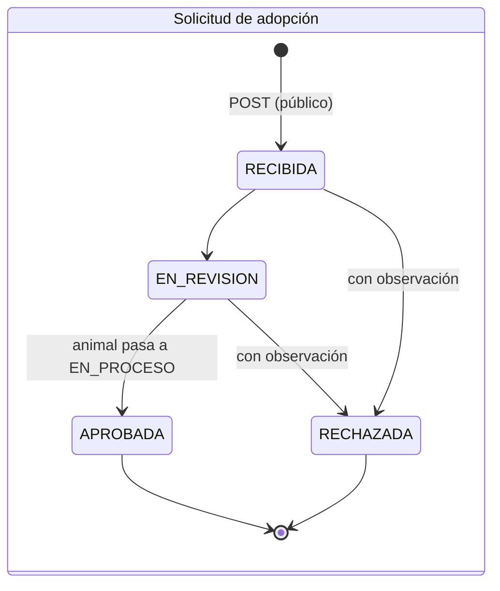
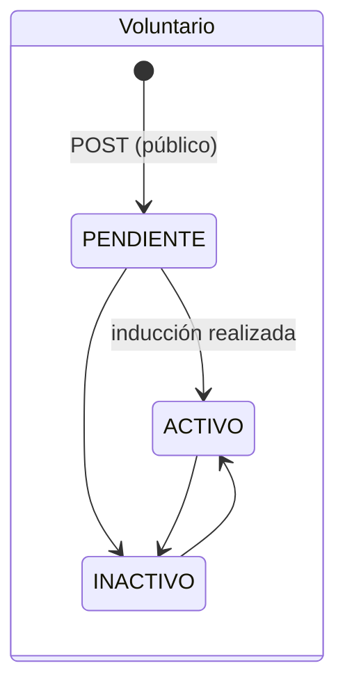

# 4. Contrato de la API REST

Actividades de la Unidad 3, clase 1: "El arquitecto decide", "Desarme el controlador", "Rompa la API", contrato de API, plantilla técnica, caso de seguridad e integridad, y "El reto del cambio".

- **Base:** `http://127.0.0.1:8000/api`
- **Formato:** JSON (`Content-Type: application/json`), nombres de campo en `snake_case`, igual que los `name` del formulario.
- **Autenticación:** `Authorization: Bearer <token>` (solo para operaciones de administrador).
- **Implementación:** Django 5.2 + Django REST Framework 3.16 (`backend/adopciones/`).

## 4.1 Actividad 1: El arquitecto decide (CRUD del recurso Animal)

| # | Operación | Recurso | Método | Endpoint | Entrada | Respuesta | Código HTTP |
|---|---|---|---|---|---|---|---|
| 1 | Consultar información | Animal | GET | `/api/animales/` | Filtros opcionales `?especie=perro\|gato` y `?estado=DISPONIBLE\|EN_PROCESO\|ADOPTADO` | Lista de animales | 200 · 400 filtro inválido |
| 2 | Consultar un elemento | Animal | GET | `/api/animales/{id}/` | `id` en la ruta | Un animal | 200 · 404 |
| 3 | Crear | Animal | POST | `/api/animales/` | JSON con nombre, especie, raza, sexo, edad_meses, tamano, salud, descripcion (y opcionales historia, foto, foto_alt, estado) | Animal creado + encabezado `Location` | 201 · 400 · 401 · 403 |
| 4 | Actualizar | Animal | PUT (completo) / PATCH (parcial) | `/api/animales/{id}/` | `id` + JSON con los campos a cambiar | Animal actualizado | 200 · 400 · 401 · 403 · 404 |
| 5 | Eliminar | Animal | DELETE | `/api/animales/{id}/` | `id` | Sin cuerpo | 204 · 401 · 403 · 404 · 409 si tiene solicitudes |

Y para la funcionalidad central:

| Operación | Método | Endpoint | Quién | Código HTTP |
|---|---|---|---|---|
| Registrar solicitud de adopción | POST | `/api/solicitudes/` | Cualquier visitante | 201 · 400 · 404 · 409 |
| Consultar solicitudes | GET | `/api/solicitudes/` | Administrador | 200 · 401 · 403 |
| Consultar una solicitud | GET | `/api/solicitudes/{id}/` | Administrador | 200 · 401 · 403 · 404 |
| Cambiar el estado de una solicitud | PATCH | `/api/solicitudes/{id}/` | Administrador | 200 · 400 · 401 · 403 · 404 · 409 |
| Registrarse como voluntario | POST | `/api/voluntarios/` | Cualquier visitante | 201 · 400 · 409 |
| Consultar voluntarios | GET | `/api/voluntarios/` | Administrador | 200 · 401 · 403 |
| Consultar un voluntario | GET | `/api/voluntarios/{id}/` | Administrador | 200 · 401 · 403 · 404 |
| Cambiar el estado de un voluntario | PATCH | `/api/voluntarios/{id}/` | Administrador | 200 · 400 · 401 · 403 · 404 · 409 |
| Iniciar sesión | POST | `/api/sesion/` | Cualquiera (máximo 10 intentos por minuto) | 200 · 400 · 401 · 429 |
| Cerrar sesión | DELETE | `/api/sesion/` | Usuario con token | 204 · 401 |

**¿Por qué no hacer todo con GET?** Porque GET debe ser seguro (no cambia datos) e idempotente: los navegadores, buscadores y cachés pueden repetirlo o guardarlo. Un `GET /api/animales/borrar/5` podría ejecutarse con solo abrir un enlace o al precargar una página. Además, los datos personales del formulario quedarían en la URL y en los historiales.

## 4.2 Contrato de la funcionalidad central: `POST /api/solicitudes/`

**ENTRADA: ¿qué recibe?**

```json
{
  "animal_id": 1,
  "nombre": "María Fernanda Pérez",
  "tipo_documento": "CC",
  "documento": "1090123456",
  "fecha_nacimiento": "1995-05-10",
  "correo": "maria@correo.com",
  "telefono": "3001234567",
  "direccion": "Calle 10 # 5-20, barrio Centro",
  "ciudad": "Cúcuta",
  "tipo_vivienda": "casa",
  "tenencia": "propia",
  "personas_hogar": 3,
  "otras_mascotas": ["ninguna"],
  "horas_solo": 4,
  "fecha_visita": "2026-11-03",
  "hora_visita": "10:00",
  "motivo": "Tenemos un patio grande y tiempo para pasearla todos los días.",
  "medio": "redes",
  "acepta_datos": true,
  "acepta_visita": true
}
```

| Campo | Tipo | Obligatorio | Regla de formato |
|---|---|---|---|
| animal_id | entero o `null` | No | `null` = "Aún no lo decido, quiero orientación" |
| nombre | texto | Sí | 3 a 100 caracteres |
| tipo_documento | texto | Sí | `CC`, `CE`, `PPT`, `PA` |
| documento | texto | Sí | 5 a 15 letras o números |
| fecha_nacimiento | fecha `AAAA-MM-DD` | Sí | |
| correo | texto | Sí | correo válido |
| telefono | texto | Sí | 10 dígitos que empiezan por 3 |
| direccion, ciudad | texto | Sí | máximo 150 y 60 caracteres |
| tipo_vivienda | texto | Sí | `casa`, `apartamento`, `finca` |
| tenencia | texto | Sí | `propia`, `arrendada` |
| personas_hogar | entero | Sí | 1 a 20 |
| otras_mascotas | lista | No | valores `perro`, `gato`, `otra`, `ninguna` |
| horas_solo | entero | No | 0 a 12 |
| fecha_visita, hora_visita | fecha, hora | No | |
| motivo | texto | Sí | 20 a 1000 caracteres |
| medio | texto | No | `redes`, `amigo`, `jornada`, `otro` |
| acepta_datos, acepta_visita | booleano | Sí | |

**PROCESO: ¿qué hace?** (`SolicitudService.registrar`)

1. Verifica que acepte el tratamiento de datos (Ley 1581 de 2012) y la visita.
2. Verifica que el solicitante sea mayor de 18 años.
3. Verifica que la visita no sea en el pasado y esté entre 8:00 a. m. y 4:00 p. m.
4. Busca el animal: si no existe → 404; si no está DISPONIBLE → 409.
5. Verifica que la misma persona no tenga ya una solicitud activa para ese animal → 409.
6. Guarda la solicitud con estado `RECIBIDA` (lo decide el servidor).

**SALIDA: ¿qué devuelve?** `201 Created`, con el encabezado `Location: /api/solicitudes/2/`

```json
{
  "id": 2,
  "estado": "RECIBIDA",
  "animal": { "id": 2, "nombre": "Tomás" },
  "fecha_creacion": "2026-10-27T19:26:06.728480-05:00",
  "mensaje": "Recibimos tu solicitud #2. La revisaremos en un plazo de 3 a 5 días hábiles."
}
```

El cliente puede saber si funcionó (201), qué se creó, cuál es el id, cuál es el estado y qué sigue (el mensaje). **No siempre se devuelve 200**: 201 indica que se creó un recurso nuevo y dónde encontrarlo.

**ERRORES: ¿qué puede fallar?**

| Código | `codigo` | Cuándo |
|---|---|---|
| 400 | `JSON_INVALIDO` | El cuerpo no es JSON |
| 400 | `DATOS_INVALIDOS` | Formato incorrecto o regla del solicitante incumplida (edad, autorizaciones, horario) |
| 404 | `RECURSO_NO_ENCONTRADO` | El animal no existe |
| 409 | `CONFLICTO` | El animal no está disponible o ya existe una solicitud activa |
| 409 | `CONFLICTO` | La base de datos rechaza el registro por una restricción UNIQUE o CHECK (por ejemplo, dos envíos simultáneos) |
| 500 | `ERROR_INTERNO` | Falla inesperada (se registra en el log; al cliente no se le muestran detalles internos) |
| 503 | `SERVICIO_NO_DISPONIBLE` | La base de datos no responde. Incluye el encabezado `Retry-After: 30` |

**SEGURIDAD: ¿quién puede usarlo?** Cualquier visitante puede **enviar** una solicitud. Solo un administrador puede **consultar** las solicitudes, porque contienen datos personales.

## 4.2.1 Contrato del segundo flujo: `POST /api/voluntarios/`

Sigue las mismas capas: `VoluntariosController` → `VoluntarioService` → `VoluntarioRepository` → modelo `Voluntario`.

**ENTRADA**

```json
{
  "nombre": "Andrés Felipe Gómez",
  "correo": "andres@correo.com",
  "telefono": "3157654321",
  "edad": 22,
  "red_social": "",
  "disponibilidad": ["sabado", "domingo"],
  "area": "cuidado",
  "experiencia": true,
  "comentarios": "Tuve perros toda mi vida y quiero ayudar los fines de semana.",
  "acepta_datos": true
}
```

| Campo | Tipo | Obligatorio | Regla de formato |
|---|---|---|---|
| nombre | texto | Sí | 3 a 100 caracteres |
| correo | texto | Sí | correo válido |
| telefono | texto | Sí | 10 dígitos que empiezan por 3 |
| edad | entero | Sí | 16 a 90 |
| red_social | URL | No | URL válida o vacío |
| disponibilidad | lista | Sí, al menos uno | `entre-semana`, `sabado`, `domingo` |
| area | texto | Sí | `cuidado`, `eventos`, `transporte`, `comunicaciones`, `hogar-paso` |
| experiencia | booleano | Sí | |
| comentarios | texto | No | máximo 500 caracteres |
| acepta_datos | booleano | Sí | |

**PROCESO** (`VoluntarioService.registrar`)

1. Verifica la autorización de tratamiento de datos.
2. Regla de la fundación: **transporte** y **hogar de paso** solo para mayores de 18 años (implican llevar animales en un vehículo o tenerlos en casa). Un voluntario de 16 o 17 años puede elegir las demás áreas.
3. Un mismo correo no puede registrarse dos veces (sin importar mayúsculas) → 409.
4. Guarda con estado `PENDIENTE`; la fundación lo pasa a `ACTIVO` después de la inducción.

**SALIDA:** `201 Created`, con el encabezado `Location: /api/voluntarios/{id}/`

```json
{
  "id": 1,
  "nombre": "Andrés Felipe Gómez",
  "area": "cuidado",
  "estado": "PENDIENTE",
  "fecha_registro": "2026-10-27T19:45:12.204511-05:00",
  "mensaje": "¡Gracias, Andrés Felipe Gómez! Te escribiremos a andres@correo.com para la jornada de inducción."
}
```

**ERRORES:** 400 `DATOS_INVALIDOS` (formato, sin días, sin autorización o área no permitida para la edad) · 409 `CONFLICTO` (correo ya registrado) · 500 `ERROR_INTERNO`.

**SEGURIDAD:** cualquiera puede registrarse; solo un administrador consulta la lista de voluntarios (contiene datos de contacto). Si el cliente envía `"estado": "ACTIVO"`, se ignora (prueba T30).

## 4.2.2 Gestión del proceso: `PATCH /api/solicitudes/{id}/` y `PATCH /api/voluntarios/{id}/`

El administrador mueve cada solicitud por el proceso de adopción y activa a los voluntarios después de la inducción. Se usa **PATCH** y no PUT porque solo se modifica una parte del recurso (el estado), no se reemplaza completo.

**Entrada** (`Authorization: Bearer <token>` de un administrador)

```json
{ "estado": "RECHAZADA", "observacion": "La vivienda no tiene cerramiento para un perro mediano." }
```

| Campo | Obligatorio | Regla |
|---|---|---|
| estado | Sí | Solicitud: `EN_REVISION`, `APROBADA`, `RECHAZADA`. Voluntario: `ACTIVO`, `INACTIVO` |
| observacion | Solo al rechazar | Máximo 500 caracteres; se le comunica al solicitante |

**Estados permitidos** (la regla vive en `SolicitudService.TRANSICIONES` y `VoluntarioService.TRANSICIONES`):





**Proceso** (`SolicitudService.cambiar_estado`)

1. Solo se permiten los pasos del diagrama. Saltarse la revisión o cambiar un estado final → **409**.
2. Rechazar sin observación → **400**.
3. Aprobar exige un animal asignado (una solicitud "sin preferencia" no se puede aprobar) y que siga DISPONIBLE. El servicio vuelve a consultar el animal en la BD, porque otra solicitud para el mismo animal pudo aprobarse antes → **409**.
4. Al aprobar, el animal pasa a EN_PROCESO **en la misma transacción**: o se actualizan la solicitud y el animal, o ninguno de los dos.

**Salida:** `200 OK` con la solicitud o el voluntario completo, incluidos `estado`, `observacion` y `fecha_actualizacion`.

**Respuestas reales** (verificadas contra el servidor el 27/10/2026):

| Petición | Código | Mensaje |
|---|---|---|
| PATCH sin token | 401 | Debes enviar un token válido en el encabezado Authorization: Bearer &lt;token&gt;. |
| RECIBIDA → APROBADA | 409 | La solicitud #1 está recibida y no puede pasar a aprobada. Estados permitidos desde aquí: EN_REVISION, RECHAZADA. |
| RECIBIDA → EN_REVISION → APROBADA | 200 | Canela queda "en proceso de adopción" |
| Nueva solicitud para Canela | 409 | Canela no está disponible para adopción (estado actual: en proceso de adopción). |
| APROBADA → RECHAZADA | 409 | … Estados permitidos desde aquí: ninguno (es un estado final). |
| Voluntario ACTIVO → PENDIENTE | 409 | Pedro Suárez está activo y no puede pasar a pendiente de inducción. |

**Un servicio, dos controladores.** El panel `/admin/` de Django también puede cambiar estados, con las acciones "Pasar a EN REVISIÓN", "APROBAR", "ACTIVAR" e "INACTIVAR". Esas acciones llaman al **mismo servicio** que la API, y el campo estado es de solo lectura en el formulario del panel. Así nadie puede saltarse las reglas desde el panel (prueba T42). Rechazar solo se hace por la API, porque exige escribir la observación.

## 4.2.3 Sesión del personal: `POST` y `DELETE /api/sesion/`

Lo usa el panel del personal (`/panel/`).

**Iniciar sesión**

```http
POST /api/sesion/
{ "usuario": "coordinadora", "clave": "********" }
```

```json
{ "token": "9f2c…", "usuario": "coordinadora", "es_administrador": true }
```

| Caso | Respuesta |
|---|---|
| Credenciales correctas | 200 con el token |
| Usuario o contraseña incorrectos, o cuenta desactivada | 401 `CREDENCIALES_INVALIDAS`, **con el mismo mensaje** en todos los casos para no revelar qué usuarios existen |
| Faltan campos | 400 `DATOS_INVALIDOS` |
| Más de 10 intentos por minuto desde la misma IP | 429 `DEMASIADOS_INTENTOS` (protege contra adivinar contraseñas) |

Un usuario sin rol de administrador puede iniciar sesión (`es_administrador: false`), pero recibe 403 en las consultas de administración. La pantalla detecta ese caso, descarta el token y muestra "Tu usuario no tiene permisos de administrador".

**Cerrar sesión:** `DELETE /api/sesion/` con `Authorization: Bearer <token>` → 204. El token se **borra en el servidor**: aunque alguien lo hubiera copiado, deja de servir (401).

**Decisiones de seguridad en el frontend**

- El token se guarda en `sessionStorage`, que se borra al cerrar la pestaña, y no en `localStorage`, que quedaría guardado en el equipo.
- El token solo se envía en las peticiones de administración. Un token vencido no rompe las páginas públicas.
- Si cualquier petición responde 401 (por ejemplo, la sesión se cerró en otra pestaña), la pantalla borra la sesión y vuelve a pedir el inicio de sesión.
- Los datos de los solicitantes se insertan como texto (`textContent`), nunca como HTML. Un nombre con `<script>` no se ejecuta.
- La página lleva `noindex` para que los buscadores no la publiquen. Solo se enlaza desde el pie de página.

**Los botones salen del servidor.** Cada solicitud y cada voluntario trae `estados_siguientes`, por ejemplo `["EN_REVISION", "RECHAZADA"]`, calculado con `SolicitudService.TRANSICIONES`. La pantalla dibuja solo esos botones y no repite la regla. Si la fundación cambia el proceso, se modifica el servicio y la pantalla se adapta sola.

## 4.2.4 Entrega 4: consulta de solicitud, jornadas y filtro por tamaño

**`POST /api/solicitudes/consulta/`** (público). El solicitante ve en qué va su proceso.

```json
{ "numero": 8, "documento": "55443322" }
```

| Caso | Respuesta |
|---|---|
| Número y documento coinciden | 200 con `id`, `estado`, `estado_texto`, `animal`, `observacion`, `fecha_creacion`, `fecha_actualizacion` |
| El número no existe **o** el documento no coincide | 404 `RECURSO_NO_ENCONTRADO`, con **el mismo mensaje** en ambos casos |
| Faltan campos o el formato es inválido | 400 `DATOS_INVALIDOS` |
| Más de 10 consultas por minuto desde la misma IP | 429 `DEMASIADOS_INTENTOS` |

Decisiones de seguridad: es **POST** y no GET para que el documento no quede en la dirección, el historial ni los registros del servidor; la respuesta **no incluye datos personales** (nombre, documento, correo, teléfono, dirección); el mismo mensaje para "no existe" y "no es tuyo" impide averiguar qué solicitudes existen; y el límite de intentos impide probar documentos al azar. La regla vive en `SolicitudService.consultar`.

**`GET /api/jornadas/`** (público). Devuelve las jornadas de voluntariado de hoy en adelante, ordenadas por fecha y hora (`JornadaService.proximas`). El modelo `Jornada` tiene restricciones en la base de datos: la hora de fin debe ser posterior a la de inicio y debe haber al menos un cupo.

**`GET /api/animales/?tamano=pequeno|mediano|grande`**: nuevo filtro, combinable con `especie` y `estado`. Un valor desconocido responde 400 con el detalle en `tamano`.

## 4.3 Formato único de error

Todos los errores de la API, incluidos los del framework y los 500, tienen la misma forma (`backend/adopciones/errores.py`):

```json
{
  "error": {
    "estado": 409,
    "codigo": "CONFLICTO",
    "mensaje": "Zeus no está disponible para adopción (estado actual: en proceso de adopción).",
    "detalles": null,
    "ruta": "/api/solicitudes/",
    "fecha": "2026-10-27T19:26:06-05:00"
  }
}
```

- `estado`: código HTTP (también va en la respuesta).
- `codigo`: identificador estable para que el frontend decida qué hacer.
- `mensaje`: texto para mostrar al usuario.
- `detalles`: errores por campo (`{"telefono": ["..."]}`), útil para marcar el formulario.
- `ruta` y `fecha`: trazabilidad.

## 4.3.1 Persistencia e integridad en la fuente de datos (Unidad 3, clase 2)

La API no simula el almacenamiento: cada operación escribe en la base de datos SQLite (`backend/db.sqlite3`) mediante el ORM de Django, y la prueba `backend/verificar_persistencia.py` demuestra que un registro sigue ahí después de apagar y encender el servicio (ver `05-pruebas.md`, sección 5.6).

Los datos se validan en tres niveles:

| Nivel | Qué controla | Dónde |
|---|---|---|
| Frontend | Campos obligatorios, formatos y rangos visibles | Atributos HTML5 de las plantillas (`adoptar.html`, `voluntarios.html`) |
| Backend | Formato (serializers) y reglas del negocio (servicios) | `serializers.py`, `servicios.py` |
| Base de datos | PK, FK, NOT NULL, CHECK y UNIQUE | `models.py`, migración `0005_restricciones_de_integridad` |

Restricciones declaradas en la base de datos (rechazan el dato aunque alguien escriba sin pasar por la API):

| Tabla | Restricción | Regla |
|---|---|---|
| `adopciones_animal` | `animal_edad_maxima` (CHECK) | `edad_meses` ≤ 360 |
| `adopciones_solicitudadopcion` | `solicitud_personas_hogar_rango` (CHECK) | `personas_hogar` entre 1 y 20 |
| `adopciones_solicitudadopcion` | `solicitud_horas_solo_maximo` (CHECK) | `horas_solo` ≤ 12 |
| `adopciones_solicitudadopcion` | `solicitud_con_autorizaciones` (CHECK) | `acepta_datos` y `acepta_visita` verdaderos |
| `adopciones_solicitudadopcion` | `solicitud_activa_unica` (UNIQUE parcial) | Un documento no puede tener dos solicitudes RECIBIDA o EN_REVISION para el mismo animal |
| `adopciones_voluntario` | `voluntario_edad_rango` (CHECK) | `edad` entre 16 y 90 |
| `adopciones_voluntario` | `voluntario_con_autorizacion` (CHECK) | `acepta_datos` verdadero |

Si la base de datos rechaza un registro por una de estas restricciones, la API responde **409 `CONFLICTO`**; si la base de datos no responde, **503 `SERVICIO_NO_DISPONIBLE`** con `Retry-After`. Aprobar una solicitud cambia dos tablas (la solicitud y el animal) dentro de `transaction.atomic`: si algo falla, se revierten ambos cambios (prueba T50).

El documento técnico del taller, con el recorrido de los datos, el código de cada capa y las evidencias, está en [`Taller_Integracion_Equipo_HuellitasWeb.pdf`](Taller_Integracion_Equipo_HuellitasWeb.pdf) (versión editable en `.docx`).

## 4.4 Actividad 2: Desarme el controlador

Aplicada a nuestro `registrarSolicitud(solicitud)`:

| Responsabilidad mezclada | ¿Dónde quedó? | Archivo |
|---|---|---|
| Recibir el JSON y validar el formato | Controller + Serializer | `views.py`, `serializers.py` |
| Validar al solicitante (edad, autorizaciones) | Service | `servicios.py` |
| Validar que el animal esté disponible | Service | `servicios.py` |
| Conectar a la BD y guardar la solicitud | Repository | `repositorios.py` |
| Actualizar el estado del animal | Service decide, Repository ejecuta | `servicios.py`, `repositorios.py` |
| Enviar correo de confirmación | **Otro componente** (pendiente: un `NotificacionService`) | — |
| Construir la respuesta HTTP | Controller | `views.py` |
| Convertir errores en JSON | **Otro componente**: manejador global | `errores.py` |

**¿Qué está mezclado en la versión ingenua?** Entrada HTTP, reglas, acceso a datos y notificaciones en una sola función: no se puede probar la regla de edad sin una base de datos, ni cambiar la base de datos sin tocar el controlador.

## 4.5 Actividad 3: Rompa la API

```http
POST /api/solicitudes/
{ "animal_id": 2, "personas_hogar": -5, "fecha_nacimiento": "2012-01-01", ... }
```

| Pregunta | Respuesta |
|---|---|
| ¿Qué está mal? | `personas_hogar` es negativo (formato) y el solicitante tiene 14 años (regla de negocio) |
| ¿Quién debe detectarlo? | El número negativo, el **serializer** del controlador. La edad, el **servicio** |
| ¿Qué código HTTP? | 400 Bad Request |
| ¿Qué JSON de error? | El de abajo (respuesta real de la API) |
| ¿Debe llegar a la BD? | **No.** Se rechaza antes de llamar al servicio; la prueba T14 lo verifica |

```json
{
  "error": {
    "estado": 400,
    "codigo": "DATOS_INVALIDOS",
    "mensaje": "La solicitud tiene datos inválidos. Revisa los detalles.",
    "detalles": { "personas_hogar": ["Asegúrese de que este valor es mayor o igual a 1."] },
    "ruta": "/api/solicitudes/",
    "fecha": "2026-10-27T19:26:06-05:00"
  }
}
```

Una vez corregido el formato, la misma solicitud llega al servicio y falla por la edad:

```json
{
  "error": {
    "estado": 400,
    "codigo": "DATOS_INVALIDOS",
    "mensaje": "La solicitud no cumple los requisitos de adopción.",
    "detalles": { "fecha_nacimiento": ["Debes ser mayor de 18 años para adoptar."] },
    "ruta": "/api/solicitudes/",
    "fecha": "2026-10-27T19:26:06-05:00"
  }
}
```

## 4.6 Plantilla técnica del equipo

| Campo | Valor |
|---|---|
| Proyecto | Huellitas Web: adopción de mascotas y voluntariado |
| Funcionalidad | Registrar una solicitud de adopción |
| Método + endpoint | `POST /api/solicitudes/` |
| Request | JSON del punto 4.2 |
| Controller | `SolicitudesController.post` (`views.py`) |
| Service | `SolicitudService.registrar` (`servicios.py`) |
| Model | `SolicitudAdopcion` y `Animal` (`models.py`) |
| Repository / datos | `SolicitudRepository`, `AnimalRepository` (`repositorios.py`) sobre SQLite |
| Response | 201 con `{id, estado, animal, fecha_creacion, mensaje}` |
| Código HTTP | 201 Created |
| Error 1 | 409: el animal no está disponible (Zeus) |
| Error 2 | 400: solicitante menor de edad o datos con formato inválido |
| Prueba realizada | T13 a T21 en `backend/adopciones/tests.py` (ver `05-pruebas.md`) |

## 4.7 Caso de seguridad e integridad

En nuestra API el equivalente al "precio enviado por el cliente" es el **estado de la solicitud**. Si alguien envía `"estado": "APROBADA"`, el servidor lo ignora: el serializer de entrada no tiene ese campo y el servicio siempre guarda `RECIBIDA`. Lo mismo pasa con la disponibilidad del animal: el frontend deshabilita a Zeus en la lista, pero el backend vuelve a consultar su estado real en la base de datos (prueba T18) y no confía en lo que diga el navegador.

| Aspecto | Cómo se cubre |
|---|---|
| Autenticación (¿quién eres?) | Token `Bearer` (`autenticacion.py`); sin token → 401 |
| Autorización (¿qué puedes hacer?) | `permisos.py`: solo administradores modifican animales o leen solicitudes → 403 |
| Validación | Serializers (formato) + servicios (reglas) |
| Integridad | El servidor decide `estado`; el animal se consulta en la BD, no se toma del cliente |
| Confidencialidad | Las solicitudes (datos personales) solo las ve un administrador. **Pendiente:** HTTPS al desplegar |
| Trazabilidad | `fecha_creacion` en cada solicitud, `ruta` y `fecha` en cada error, log de errores 500 |

## 4.8 El reto del cambio

> "Los administradores pueden consultar todos los pedidos. Los clientes solo pueden consultar sus propios pedidos."

Aplicado a Huellitas: *los administradores ven todas las solicitudes; cada solicitante solo ve las suyas.*

| Pregunta | Respuesta |
|---|---|
| ¿Qué cambia en el frontend? | Una página "Mis solicitudes" con inicio de sesión del solicitante y el token guardado para enviarlo en `Authorization` |
| ¿Qué cambia en el endpoint? | Nada en la ruta: `GET /api/solicitudes/` sigue igual, pero la respuesta depende de quién la pide |
| ¿Qué cambia en el backend? | El servicio filtra: si el usuario es administrador devuelve todas; si no, `solicitudes.obtener_por_usuario(usuario)` |
| ¿Dónde se valida el permiso? | El permiso general (autenticado o no) en el controlador (`permisos.py`); la regla "solo las propias" en el **servicio**, nunca solo en el frontend |
| ¿La base de datos cambia? | Sí: `SolicitudAdopcion` necesita un campo `usuario` (llave foránea) |
| ¿Qué respuestas HTTP pueden aparecer? | 200, 401 sin sesión, 403 si se pide una solicitud ajena por id (o 404, para no revelar que existe) |
