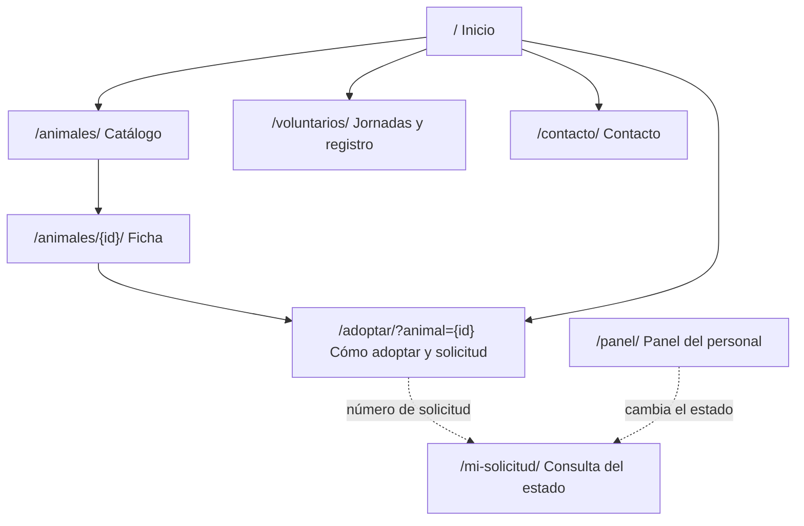
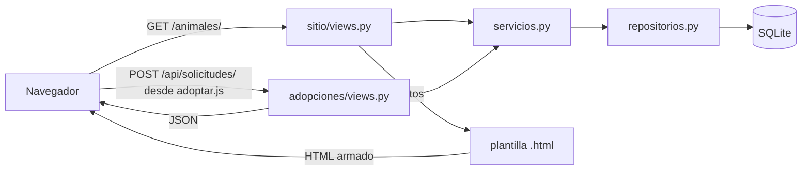

# 7. Sitio de varias páginas con Django (entrega 4)

Hasta la entrega 3 el sitio era una sola página (`index.html`) con secciones apiladas, y JavaScript dibujaba el menú, el pie y los animales. Desde la entrega 4, cada sección tiene su propia página y Django arma cada una en el servidor con **plantillas**. La API REST se mantiene: los formularios y el panel la siguen usando.

## 7.1 Mapa del sitio

| Dirección | Vista (`sitio/views.py`) | Plantilla | Datos que pide | JavaScript |
|---|---|---|---|---|
| `/` | `inicio` | `inicio.html` | `AnimalService.listar(estado=DISPONIBLE)`, `JornadaService.proximas()` | No |
| `/animales/` | `animales` | `animales.html` | `AnimalService.listar(especie, tamano)` | No |
| `/animales/{id}/` | `ficha` | `animal.html` | `AnimalService.obtener(id)`; si no existe, 404 | No |
| `/adoptar/` | `adoptar` | `adoptar.html` | `AnimalService.listar()` para la lista del formulario | `adoptar.js` → `POST /api/solicitudes/` |
| `/voluntarios/` | `voluntarios` | `voluntarios.html` | `JornadaService.proximas()` | `voluntarios.js` → `POST /api/voluntarios/` |
| `/mi-solicitud/` | `consulta` | `consulta.html` | — | `consulta.js` → `POST /api/solicitudes/consulta/` |
| `/contacto/` | `contacto` | `contacto.html` | — | No |
| `/panel/` | `panel` | `panel.html` | — | `admin.js` → sesión, `GET` y `PATCH` de la API |

## 7.2 Cómo encaja con MVC y las capas

En Django, MVC se llama **MTV** (Modelo, Plantilla, Vista):

| MVC (clase) | Django | En el proyecto |
|---|---|---|
| Modelo | Model | `adopciones/models.py`, con las reglas en `servicios.py` y el acceso a datos en `repositorios.py` |
| Vista | Template | `sitio/templates/sitio/*.html` |
| Controlador | View | `sitio/views.py` (páginas) y `adopciones/views.py` (API) |

Las dos puertas de entrada, las páginas y la API, llaman a **los mismos servicios**. Las reglas del negocio no se duplican, que es lo que pedía la clase de persistencia: «si web y móvil registran productos, ¿deben duplicarse las reglas? No».

## 7.3 De componentes de JavaScript a plantillas

| Antes (entrega 2 y 3) | Ahora (entrega 4) | Por qué |
|---|---|---|
| `<hh-encabezado>` y `<hh-pie>` en `componentes.js` | `base.html`, heredada por cada página con `` | El menú y el pie se escriben una vez y llegan ya armados, aunque JavaScript falle |
| `tarjetaAnimal()` en JavaScript | `_tarjeta_animal.html` con `` | El catálogo se ve sin esperar a la API |
| `enlaceAdopcion()` | `_boton_adoptar.html` | Lo usan la tarjeta y la ficha |
| Filtros con botones y `fetch` | Enlaces `?especie=…&tamano=…` | Cada filtro tiene su propia dirección y se puede compartir |
| `index.html?animal=3#solicitud` | `/adoptar/?animal=3#solicitud`, elegido por el servidor | Sin JavaScript para preseleccionar |
| `animal.html?id=3` | `/animales/3/` | Direcciones limpias y un 404 real si no existe |

`componentes.js` quedó solo con `crear()` y `mostrarMensaje()`, que usan los formularios y el panel.

## 7.4 Funciones nuevas

- **Mi solicitud** (`/mi-solicitud/`): el solicitante escribe el número que recibió al enviar la solicitud y su documento, y ve el estado, el animal, las fechas y, si fue rechazada, el motivo. El contrato y las decisiones de seguridad están en `04-contrato-api.md`, sección 4.2.4.
- **Jornadas en la base de datos**: el modelo `Jornada` reemplaza la tabla escrita a mano. Se administran en `/admin/` y solo se publican las de hoy en adelante, en `/voluntarios/` y como "Próxima jornada" en el inicio.
- **Filtro por tamaño** en el catálogo y en `GET /api/animales/?tamano=`.
- **Página 404 propia** para animales o direcciones que no existen.

## 7.5 Lo que se eliminó

- La carpeta `refugio-html5/`. Sus imágenes, CSS y JavaScript pasaron a `backend/sitio/static/` (con su historial en git) y su HTML se convirtió en plantillas.
- `detalle.js` y la parte del catálogo de `inicio.js`, que ahora se llama `adoptar.js`.
- La configuración de CORS (`django-cors-headers`): las páginas y la API comparten origen.
- Abrir las páginas con doble clic ya no aplica: las arma Django, así que se abren con el servidor encendido.
